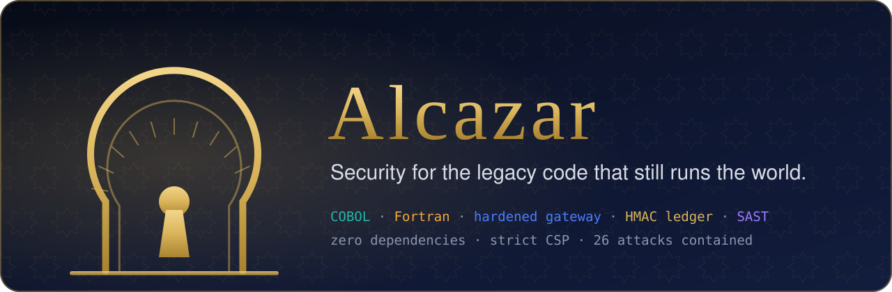
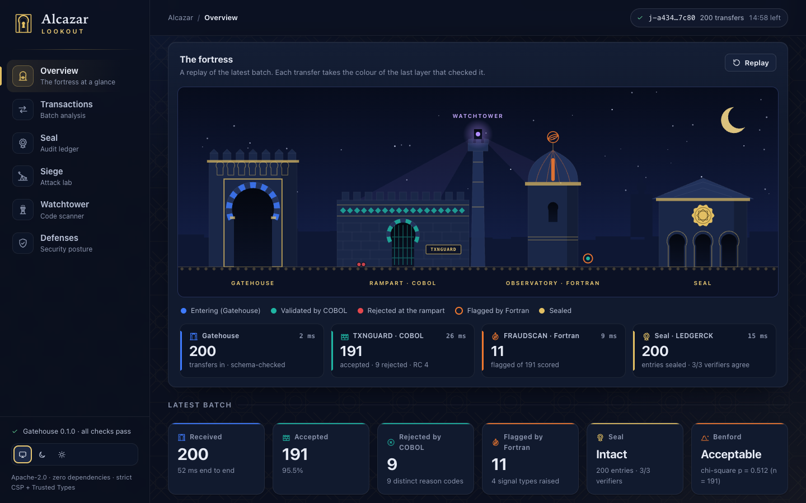
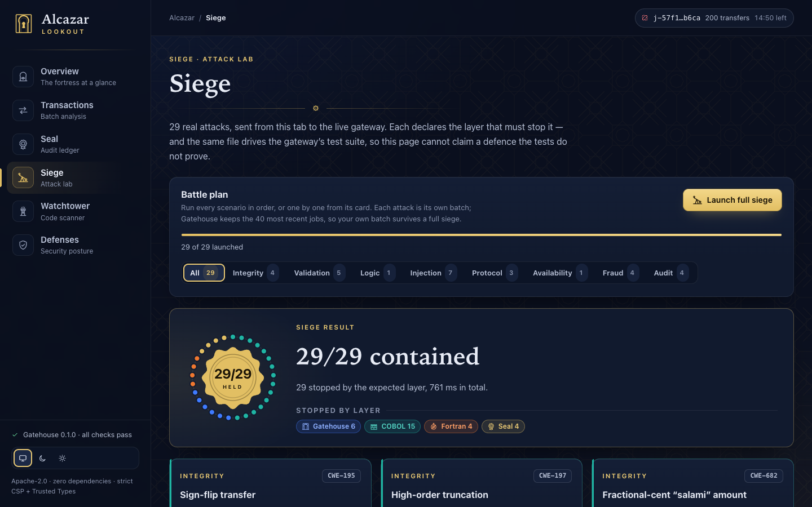
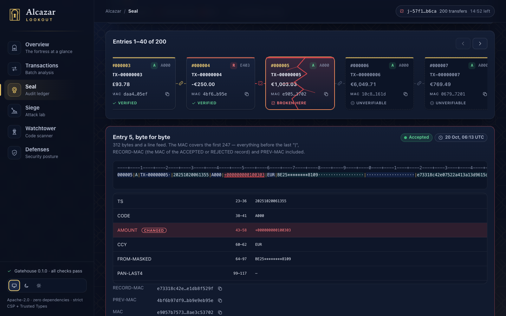
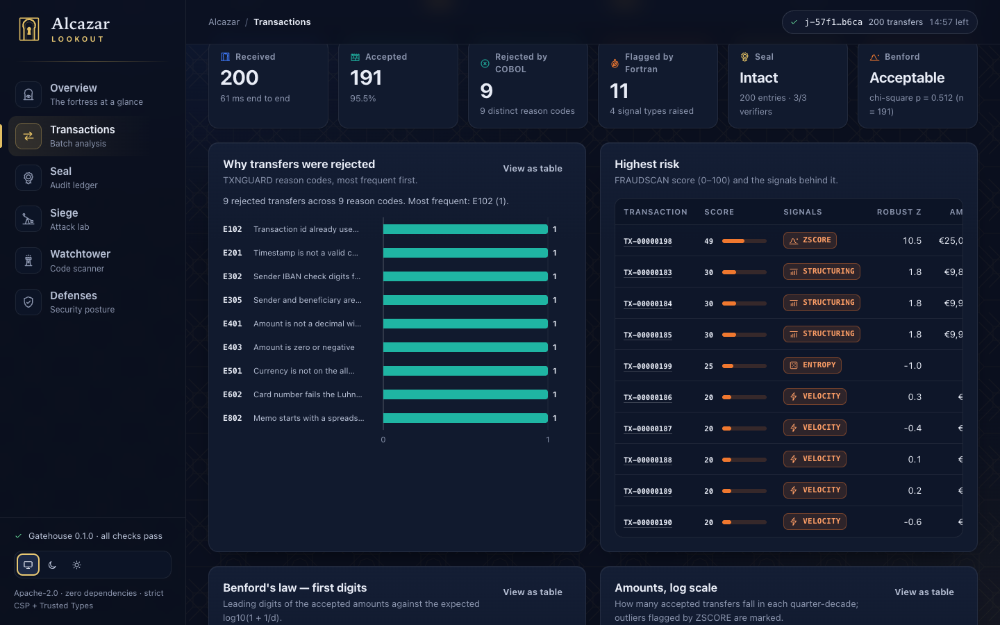
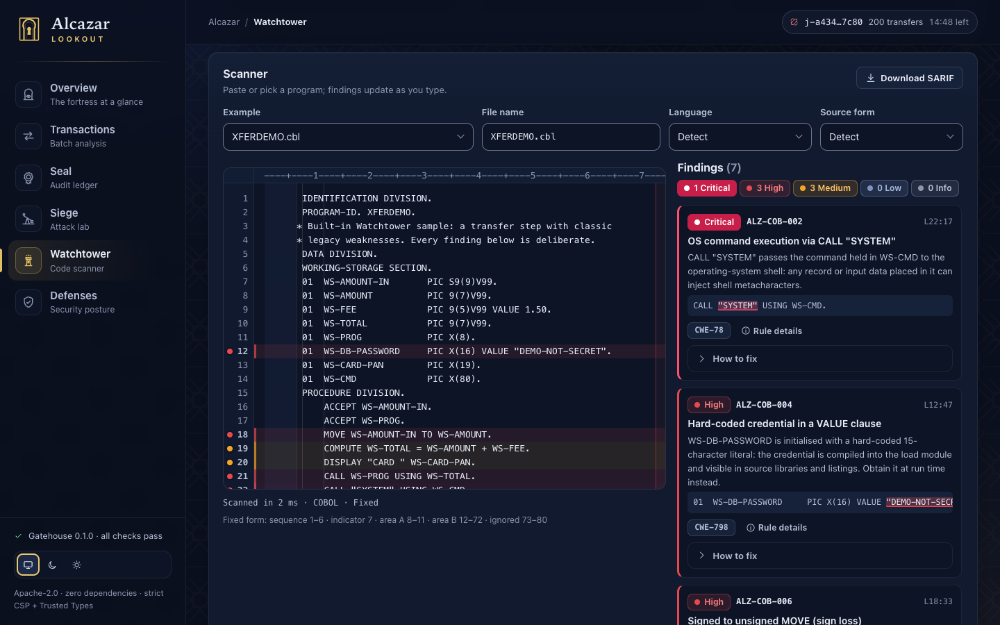
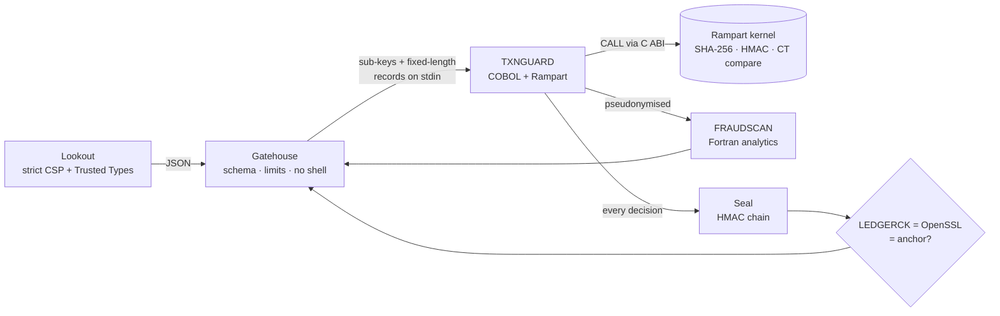

<p align="center">
  
</p>

<p align="center">
  <a href="https://github.com/Manuelma4/alcazar/actions/workflows/ci.yml"></a>
  <a href="LICENSE"></a>
  
  
  
  
</p>

COBOL still settles a large share of the world's card payments and bank
transfers; Fortran still runs weather, physics and risk models.
Modernisation projects are now putting web front ends and APIs on top of
that code — exposing programs written for closed mainframes to hostile input
from the internet.

**Alcazar** is a complete, working, open-source answer to *"how do we do that
safely?"* It is named after the Alcázar of Seville: a medieval fortress that
is still standing — and still in use. Like the code it protects.

| | Part | What it is | Built with |
|-|------|------------|-----------|
|  | **[Rampart](rampart/)** | Security libraries: character policies, IBAN and card validation, card numbers found in free text, PCI DSS masking, strict amount parsing — and a Fortran kernel with SHA-256, HMAC, constant-time comparison and robust statistics behind a C ABI | COBOL, Fortran 2018 |
|  | **Seal** | An HMAC-SHA256-chained audit ledger that also seals every decision record, verified twice (COBOL + Fortran, and OpenSSL) plus an external anchor | COBOL, Fortran |
|  | **[Watchtower](watchtower/)** | A static analyzer for the vulnerabilities specific to COBOL and Fortran, with SARIF output for GitHub code scanning | JavaScript |
|  | **[Gatehouse](gatehouse/)** | The only door: a hardened gateway that runs the legacy programs without a shell, with an allow-listed environment and resource limits | Node.js, zero dependencies |
|  | **Siege** | 29 attacks, each contained by a named layer — in the dashboard *and* in CI | Shared JavaScript |
|  | **[Lookout](lookout/)** | The dashboard: watch batches flow through the fortress, tamper with the ledger, launch the Siege, scan code in the browser | HTML, CSS, JS — strict CSP, Trusted Types |

<p align="center">
  
</p>

<table>
  <tr>
    <td width="50%"><br><sub><b>Siege</b> — 29 real attacks against the live gateway, each contained by the layer that claims it.</sub></td>
    <td width="50%"><br><sub><b>Seal</b> — edit one byte of the ledger, or of a record it seals, and the chain cracks exactly there.</sub></td>
  </tr>
  <tr>
    <td width="50%"><br><sub><b>Transactions</b> — why COBOL rejected each transfer, and what Fortran flagged.</sub></td>
    <td width="50%"><br><sub><b>Watchtower</b> — the static analyzer, running entirely in the browser tab.</sub></td>
  </tr>
</table>

## Quick start

**Docker** (nothing else needed):

```bash
docker compose up --build
```

Then open <http://localhost:8080/>. The image build compiles the COBOL and
Fortran core **and runs its test suites**: an image cannot be built from code
that fails them.

**Native** (macOS or Linux):

```bash
brew install gnucobol gcc        # Debian/Ubuntu: sudo apt install gnucobol3 gfortran make
make && make test                # warnings are errors; 267 COBOL/Fortran checks
npm test                         # Gatehouse, Siege, Watchtower and Lookout tests
npm start                        # Gatehouse under the Node.js permission model
```

Node.js ≥ 22.13 is required (24 recommended). There is no `npm install`:
Alcazar has no dependencies, runtime or development.

**Just the batch core**, from a terminal:

```console
$ make demo
== TXNGUARD (COBOL) ==========================================
ALZ-SEAL|ENTRIES=000016|HEAD=bb2d92cec5aa9a83...
return code 4 (0 all accepted, 4 some rejected)
  RECORDS=16  ACCEPTED=4  REJECTED=12  LEDGER-ENTRIES=16  SELFTEST=PASS
Rejected records:
  000002TX-0002     E403AMOUNT      NOT-POSITIVE
  000003TX-0003     E402AMOUNT      MORE-THAN-13-DIGITS
  000005TX-0005     E302FROM-IBAN   MOD-97
  000009TX-0001     E102TXN-ID      REPLAY
  000013A??? -?? ?  E101TXN-ID      POS=002
  ...
== LEDGERCK (COBOL + Fortran HMAC) ===========================
ALZ-LEDGER|STATUS=OK|ENTRIES=000016|HEAD=bb2d92cec5aa9a83...
Tampering with the amount of entry 2...
ALZ-LEDGER|STATUS=BROKEN|ENTRIES=000001|SEQ=000002|REASON=MAC-MISMATCH
...
== Auditor (K_ledger only, both verifiers, the anchor) =======
node-openssl   BROKEN at entry 2: MAC-MISMATCH (1 verified before it)
cobol-fortran  BROKEN at entry 2: MAC-MISMATCH (1 verified before it)
verdict        BROKEN
```

An auditor checks a sealed job the same way, outside Gatehouse and with
`K_ledger` alone — no master key, no token key:
`node scripts/verify-ledger.mjs <job-dir> <job-id> --ledger-key-file K_LEDGER.key --entries N --head HEX`.

## How a transfer is judged



1. **Gatehouse** checks structure only — JSON types, lengths, printable ASCII,
   no unknown keys, at most 1,000 transfers — and pipes fixed-length records
   to TXNGUARD's stdin, after its keys: raw card numbers never touch the disk.
2. **TXNGUARD** (COBOL) re-checks everything and applies the business rules
   with Rampart: IBAN check digits, Luhn, a strict amount grammar that refuses
   to truncate, per-currency transfer limits, an ISO 4217 allowlist, real
   calendar dates, replays, the SEPA character set, spreadsheet-formula
   prefixes, card numbers typed into the memo. Accounts leave it only as
   HMAC tokens and masked IBANs; card numbers only as BIN + last 4.
3. **FRAUDSCAN** (Fortran) scores what was accepted: Benford's law (chi-square
   with p-value, Nigrini MAD), robust z-scores against each sender's own
   history, structuring just under the reporting threshold, velocity bursts
   and high-entropy memos (exfiltration) — currency by currency, never
   comparing kronor with euros.
4. **Seal**: every record, accepted or rejected, is sealed with
   `HMAC-SHA256(K_ledger, entry ‖ record MAC ‖ previous MAC)` — the entry
   binds the whole ACCEPTED or REJECTED record, so not one byte of a decision
   (beneficiary, channel, memo) can change unseen. Gatehouse verifies the
   ledger with LEDGERCK *and* with Node's OpenSSL — a differential test feeds
   both hundreds of corrupted files and they must agree every time — and
   compares the head with the anchor it kept, so even a truncated ledger is
   caught.

A 200-transfer batch goes through all four in about **50 ms**, and the
GnuCOBOL and gfortran run-time checks cost only 2–21 %
([benchmarks](docs/BENCHMARKS.md)).

## The Siege

Every attack below is launched from the dashboard against the real gateway,
and the same list runs in CI (`gatehouse/test/siege.test.mjs`) — including
against the production container image. The dashboard cannot claim a
defence the tests do not prove.

| # | Attack | Contained by | Result | CWE |
|--:|--------|--------------|--------|-----|
| 1 | Sign-flip transfer | TXNGUARD (COBOL) | `E403` | [CWE-195](https://cwe.mitre.org/data/definitions/195.html) |
| 2 | High-order truncation | TXNGUARD (COBOL) | `E402` | [CWE-197](https://cwe.mitre.org/data/definitions/197.html) |
| 3 | Fractional-cent “salami” amount | TXNGUARD (COBOL) | `E401` | [CWE-682](https://cwe.mitre.org/data/definitions/682.html) |
| 4 | Forged IBAN check digits | TXNGUARD (COBOL) | `E302` | [CWE-354](https://cwe.mitre.org/data/definitions/354.html) |
| 5 | IBAN alias (check digits 99) | TXNGUARD (COBOL) | `E302` | [CWE-1289](https://cwe.mitre.org/data/definitions/1289.html) |
| 6 | Invalid card number | TXNGUARD (COBOL) | `E602` | [CWE-354](https://cwe.mitre.org/data/definitions/354.html) |
| 7 | Unlisted currency | TXNGUARD (COBOL) | `E501` | [CWE-20](https://cwe.mitre.org/data/definitions/20.html) |
| 8 | Impossible date (30 February) | TXNGUARD (COBOL) | `E201` | [CWE-20](https://cwe.mitre.org/data/definitions/20.html) |
| 9 | Replayed transaction id | TXNGUARD (COBOL) | `E102` | [CWE-294](https://cwe.mitre.org/data/definitions/294.html) |
| 10 | Self-transfer loop | TXNGUARD (COBOL) | `E305` | [CWE-840](https://cwe.mitre.org/data/definitions/840.html) |
| 11 | Spreadsheet formula injection | TXNGUARD (COBOL) | `E802` | [CWE-1236](https://cwe.mitre.org/data/definitions/1236.html) |
| 12 | Card number in the memo | TXNGUARD (COBOL) | `E803` | [CWE-312](https://cwe.mitre.org/data/definitions/312.html) |
| 13 | Stored XSS in the memo | TXNGUARD (COBOL) | `E801` | [CWE-79](https://cwe.mitre.org/data/definitions/79.html) |
| 14 | SQL injection payload | TXNGUARD (COBOL) | `E801` | [CWE-89](https://cwe.mitre.org/data/definitions/89.html) |
| 15 | Shell metacharacters in the id | TXNGUARD (COBOL) | `E101` | [CWE-78](https://cwe.mitre.org/data/definitions/78.html) |
| 16 | Record injection (CR/LF) | Gatehouse | `P-CHARSET` | [CWE-93](https://cwe.mitre.org/data/definitions/93.html) |
| 17 | Bidirectional text (Trojan Source) | Gatehouse | `P-CHARSET` | [CWE-451](https://cwe.mitre.org/data/definitions/451.html) |
| 18 | Prototype pollution | Gatehouse | `P-SCHEMA` | [CWE-1321](https://cwe.mitre.org/data/definitions/1321.html) |
| 19 | Cross-site form post | Gatehouse | `P-MEDIA` | [CWE-352](https://cwe.mitre.org/data/definitions/352.html) |
| 20 | Path traversal | Gatehouse | `P-NOTFOUND` | [CWE-22](https://cwe.mitre.org/data/definitions/22.html) |
| 21 | Oversized batch | Gatehouse | `P-LIMIT` | [CWE-770](https://cwe.mitre.org/data/definitions/770.html) |
| 22 | Structuring (smurfing) | FRAUDSCAN (Fortran) | `STRUCTURING` signal | AML typology |
| 23 | Card-testing velocity | FRAUDSCAN (Fortran) | `VELOCITY` signal | AML typology |
| 24 | Account-takeover outlier | FRAUDSCAN (Fortran) | `ZSCORE` signal | AML typology |
| 25 | Data exfiltration via memo | FRAUDSCAN (Fortran) | `ENTROPY` signal | [CWE-200](https://cwe.mitre.org/data/definitions/200.html) |
| 26 | Insider edits the ledger | Seal | `MAC-MISMATCH` | [CWE-345](https://cwe.mitre.org/data/definitions/345.html) |
| 27 | Redirected payment (record edited, ledger untouched) | Seal | `RECORD-MISMATCH` | [CWE-353](https://cwe.mitre.org/data/definitions/353.html) |
| 28 | Deleted audit entry | Seal | `SEQ-GAP` | [CWE-345](https://cwe.mitre.org/data/definitions/345.html) |
| 29 | Truncated ledger | Seal | `HEAD-MISMATCH` | [CWE-345](https://cwe.mitre.org/data/definitions/345.html) |

## Watchtower

A static analyzer for the vulnerabilities that are specific to legacy code —
the ones generic SAST tools do not know about: sign-losing `MOVE`s, silent
truncation, dynamic `CALL` targets, code hidden past column 72, LINE
SEQUENTIAL record splitting, Fortran's non-short-circuit bounds checks,
trailing-blank string comparison of secrets, implicit typing, Trojan Source.

```console
$ node watchtower/bin/watchtower.mjs scan examples/vulnerable/ACCTXFER.cbl
▸ examples/vulnerable/ACCTXFER.cbl  cobol · fixed · 15 findings

   HIGH      ALZ-COB-006  Signed to unsigned MOVE (sign loss)  CWE-195
  examples/vulnerable/ACCTXFER.cbl:79:32
   79 │ 007900     MOVE WS-XFER-AMT TO WS-POSTED-AMT
      │                                ^^^^^^^^^^^^^
  Signed WS-XFER-AMT (PIC S9(9)V99) is moved to unsigned WS-POSTED-AMT
  (PIC 9(9)V99): a negative value silently loses its sign (-500.00 becomes 500.00).
```

* **34 rules** — 17 COBOL, 14 Fortran, 3 for any language — each with a page
  in [`docs/rules/`](docs/rules/): why it matters on a real mainframe or HPC
  system, vulnerable and fixed code, references.
* **Text, JSON and SARIF 2.1.0** for GitHub code scanning (security severity,
  CWE tags, stable fingerprints, in-source suppressions).
* **Suppressions must be justified**, or they are ignored:
  `*> watchtower-ignore ALZ-COB-006 -- amount validated positive above`.
* **Zero dependencies, ReDoS-safe hand-written lexers**, and a browser-safe
  core: Lookout scans pasted code without a server round-trip.
* **Dogfooded**: CI fails if Watchtower finds anything in Alcazar's own COBOL
  and Fortran — and if it stops finding all 34 rules in `examples/vulnerable`.

Watchtower is also a **GitHub Action** — scan your own legacy code on every
pull request:

```yaml
# .github/workflows/watchtower.yml, in your repository
permissions:
  contents: read
  security-events: write
jobs:
  watchtower:
    runs-on: ubuntu-latest
    steps:
      - uses: actions/checkout@3d3c42e5aac5ba805825da76410c181273ba90b1 # v7.0.1
      - uses: Manuelma4/alcazar/watchtower@main   # pin a release commit SHA in production
        with:
          paths: src/cobol src/fortran
          fail-on: high
      - uses: github/codeql-action/upload-sarif@6f2ac81f5cd81fe351a197ba0b00d91d03cd2aee # v4.39.0
        if: always()
        with:
          sarif_file: watchtower.sarif
```

<details open><summary><b>COBOL</b> — 17 rules</summary>

| Rule | Finds | Severity | CWE |
|------|-------|----------|-----|
| [ALZ-COB-001](docs/rules/ALZ-COB-001.md) | Dynamic CALL target from a data item | high | CWE-470 |
| [ALZ-COB-002](docs/rules/ALZ-COB-002.md) | OS command execution via CALL "SYSTEM" | critical | CWE-78 |
| [ALZ-COB-003](docs/rules/ALZ-COB-003.md) | Dynamic SQL built from a host variable | high | CWE-89 |
| [ALZ-COB-004](docs/rules/ALZ-COB-004.md) | Hard-coded credential in a VALUE clause | high | CWE-798 |
| [ALZ-COB-005](docs/rules/ALZ-COB-005.md) | Sensitive data written with DISPLAY | medium | CWE-532 |
| [ALZ-COB-006](docs/rules/ALZ-COB-006.md) | Signed to unsigned MOVE (sign loss) | high | CWE-195 |
| [ALZ-COB-007](docs/rules/ALZ-COB-007.md) | Numeric truncation in MOVE | medium | CWE-197 |
| [ALZ-COB-008](docs/rules/ALZ-COB-008.md) | Alphanumeric truncation in MOVE | low | CWE-222 |
| [ALZ-COB-009](docs/rules/ALZ-COB-009.md) | Monetary arithmetic without ON SIZE ERROR | medium | CWE-190 |
| [ALZ-COB-010](docs/rules/ALZ-COB-010.md) | Division without ON SIZE ERROR | medium | CWE-369 |
| [ALZ-COB-011](docs/rules/ALZ-COB-011.md) | Floating-point USAGE for a monetary field | medium | CWE-1339 |
| [ALZ-COB-012](docs/rules/ALZ-COB-012.md) | File without FILE STATUS | low | CWE-252 |
| [ALZ-COB-013](docs/rules/ALZ-COB-013.md) | Monetary multiplication or division without ROUNDED | low | CWE-682 |
| [ALZ-COB-014](docs/rules/ALZ-COB-014.md) | Code-like text beyond column 72 | medium | CWE-561 |
| [ALZ-COB-015](docs/rules/ALZ-COB-015.md) | ALTER statement (self-modifying control flow) | low | CWE-691 |
| [ALZ-COB-016](docs/rules/ALZ-COB-016.md) | LINE SEQUENTIAL input without record-length check | medium | CWE-130 |
| [ALZ-COB-017](docs/rules/ALZ-COB-017.md) | Secret read with ACCEPT (stdio keeps a copy) | low | CWE-316 |

</details>

<details><summary><b>Fortran</b> — 14 rules</summary>

| Rule | Finds | Severity | CWE |
|------|-------|----------|-----|
| [ALZ-FOR-001](docs/rules/ALZ-FOR-001.md) | Missing IMPLICIT NONE | medium | CWE-457 |
| [ALZ-FOR-002](docs/rules/ALZ-FOR-002.md) | Assumed-size dummy array | medium | CWE-119 |
| [ALZ-FOR-003](docs/rules/ALZ-FOR-003.md) | EQUIVALENCE storage aliasing | medium | CWE-843 |
| [ALZ-FOR-004](docs/rules/ALZ-FOR-004.md) | COMMON block (unchecked global storage) | low | CWE-1108 |
| [ALZ-FOR-005](docs/rules/ALZ-FOR-005.md) | Floating-point equality comparison | low | CWE-1077 |
| [ALZ-FOR-006](docs/rules/ALZ-FOR-006.md) | I/O statement without IOSTAT= | low | CWE-252 |
| [ALZ-FOR-007](docs/rules/ALZ-FOR-007.md) | OS command execution | high | CWE-78 |
| [ALZ-FOR-008](docs/rules/ALZ-FOR-008.md) | Non-constant-time comparison of a secret | high | CWE-208 |
| [ALZ-FOR-009](docs/rules/ALZ-FOR-009.md) | Hard-coded credential | high | CWE-798 |
| [ALZ-FOR-010](docs/rules/ALZ-FOR-010.md) | Single-precision REAL for money | medium | CWE-1339 |
| [ALZ-FOR-011](docs/rules/ALZ-FOR-011.md) | Format string taken from a variable | low | CWE-134 |
| [ALZ-FOR-012](docs/rules/ALZ-FOR-012.md) | Non-cryptographic PRNG used for secrets | high | CWE-338 |
| [ALZ-FOR-013](docs/rules/ALZ-FOR-013.md) | Obsolescent control flow (arithmetic IF, computed or assigned GO TO) | low | CWE-691 |
| [ALZ-FOR-014](docs/rules/ALZ-FOR-014.md) | Bounds check not short-circuited | medium | CWE-125 |

</details>

<details><summary><b>Any language</b> — 3 rules</summary>

| Rule | Finds | Severity | CWE |
|------|-------|----------|-----|
| [ALZ-GEN-001](docs/rules/ALZ-GEN-001.md) | Bidirectional control character (Trojan Source) | critical | CWE-451 |
| [ALZ-GEN-002](docs/rules/ALZ-GEN-002.md) | Invisible character or non-ASCII identifier (homoglyph) | high | CWE-1007 |
| [ALZ-GEN-003](docs/rules/ALZ-GEN-003.md) | Secret material in source | high | CWE-798 |

</details>

More in the [Watchtower README](watchtower/README.md).

## Security design, in one screen

* **Zero dependencies.** No npm packages (runtime *or* dev), base images
  pinned by digest, GitHub Actions pinned by commit SHA, Dependabot on all
  three.
* **No shell, ever.** Legacy programs are spawned with an argv array, an
  allow-listed environment (two variables), a wall-clock timeout, bounded
  output and — on Linux — `prlimit` CPU, memory, file-size and core limits.
* **Least-privilege keys, on stdin.** The 256-bit master key never leaves
  Gatehouse: each legacy program reads only the purpose-specific sub-keys it
  needs from stdin (TXNGUARD: ledger + token; LEDGERCK: ledger only) — never
  argv, never the environment — and wipes them before it exits.
* **Fail closed.** Every program starts with known-answer self-tests (NIST,
  RFC 4231) and Gatehouse refuses batches if the full pipeline does not match
  OpenSSL bit for bit at start-up.
* **Strict browser policy.** `default-src 'none'`, Trusted Types required,
  COOP/COEP/CORP, no inline code, DOM built without HTML parsing.
* **Defence in depth.** Gatehouse validates structure, COBOL re-validates
  everything, Gatehouse re-parses the legacy outputs as untrusted data.
* **Least privilege at run time.** Non-root container, read-only root file
  system, all capabilities dropped, `no-new-privileges`, the Node.js
  permission model (read the app, write only the job directory).

Details: [walkthrough: hardening a COBOL program](docs/WALKTHROUGH.md) ·
[threat model](docs/THREAT_MODEL.md) ·
[hardening notes](docs/HARDENING.md) ·
[architecture and API](docs/ARCHITECTURE.md) · [benchmarks](docs/BENCHMARKS.md) ·
[security policy](SECURITY.md)

## Lessons from the trenches

Building this surfaced real, measurable traps — each now has a defence and a
test ([all 22](docs/HARDENING.md)):

* GnuCOBOL **splits an over-long LINE SEQUENTIAL line into extra records**,
  **trims the trailing blanks of every record it writes** (so a MAC of the
  record is not a MAC of the file), and a short final record keeps the
  previous record's bytes — all with status `00`.
* COBOL's **`ACCEPT` keeps a copy of every line it reads** in buffers no
  program can wipe: three copies of the hex keys survived the wipe, until
  the keys were read with `read(2)`.
* A Fortran **module named like a C binding label** compiled into infinite
  recursion; only `-fcheck=recursion` noticed.
* gfortran **may skip impure functions in `.and.`** — a self-test that silently
  skips a check.
* `F0.6` writes 0.5 as **`.500000`, which is not JSON**.
* **Statistics lie across currencies**: 5,000 SEK next to a sender's 50 EUR
  transfers is a 100× "outlier", and a fixed 9,000–10,000 band calls 9,500 SEK
  structuring. FRAUDSCAN never compares the two.
* Under Node's permission model, **`spawn()` writes into the `env` object you
  pass**, paths are compared byte for byte (NFC vs NFD on macOS), and a grant
  for a directory that does not exist yet covers nothing inside it.

## Repository layout

```text
rampart/        COBOL modules + copybooks, Fortran kernel, C header, tests
apps/           TXNGUARD.cob, LEDGERCK.cob (COBOL) and fraudscan.f90 (Fortran)
gatehouse/      the gateway (src/) and its tests, including the Siege (test/)
watchtower/     the static analyzer: CLI, browser-safe core, tests
lookout/        the dashboard
shared/         Siege scenarios used by the dashboard and the tests
examples/       a sample batch, plus vulnerable and hardened legacy programs
docs/           architecture, threat model, hardening notes, rule pages
```

## Development

```bash
make check              # build + COBOL/Fortran tests + Node tests + self-scan
npm run start:dev       # http://localhost:8080 with live reload of lookout/
npm run check:unicode   # Trojan Source guard
```

See [CONTRIBUTING.md](CONTRIBUTING.md) for the coding rules of each language.

## Roadmap

* EBCDIC sources and IBM Enterprise COBOL dialect support in Watchtower.
* A pluggable crypto backend (OpenSSL or libsodium) behind `alz.h`.
* Durable ledger anchoring (transparency log or WORM storage).
* SBOM and signed container images.
* More Siege scenarios — contributions welcome.

## License

[Apache-2.0](LICENSE). Test card numbers are the public test numbers of the
card schemes; IBANs in samples are the standard documentation examples or
randomly generated.
