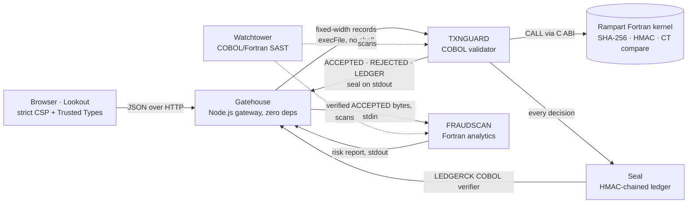

# Architecture

Alcazar wraps a legacy-style batch core (COBOL + Fortran) in modern, hardened
layers. Every layer validates what it receives, even from the layer in front of
it ("never trust the front").



| Component | Directory | Role |
|-----------|-----------|------|
| **Rampart** | `rampart/` | Runtime security libraries for COBOL and Fortran |
| **Seal** | `apps/txnguard`, `apps/ledgerck` | HMAC-chained, tamper-evident audit ledger |
| — | `apps/` | The demo "legacy bank" batch programs (TXNGUARD, LEDGERCK, FRAUDSCAN) |
| **Watchtower** | `watchtower/` | Static analyzer for COBOL & Fortran (text / JSON / SARIF) |
| **Gatehouse** | `gatehouse/` | Hardened HTTP gateway that runs the legacy programs safely |
| **Lookout** | `lookout/` | Dashboard |
| **Siege** | `shared/lab.mjs` | Attack lab shared by the dashboard and the test suite |

## 1. Batch job lifecycle

1. `POST /api/batch` — Gatehouse validates the JSON structurally (types, lengths,
   printable ASCII only, no unknown keys, ≤ 1000 transactions).
2. Gatehouse creates a private job directory (`0700`) and writes `TXNIN.DAT`
   (fixed-width, 200 bytes/record).
3. Gatehouse runs `txnguard <job-id>` with `cwd` = job dir, a minimal environment,
   no shell, a timeout and resource limits. The sub-keys it needs, `K_ledger`
   and `K_token`, are sent on **stdin** as two lines of hex (never argv/env);
   the master key never reaches a legacy program.
4. TXNGUARD runs the Fortran crypto power-on self-test, validates every record
   with the Rampart COBOL modules, writes `ACCEPTED.DAT`, `REJECTED.DAT`,
   `LEDGER.DAT`, `SUMMARY.DAT`, prints the seal on stdout
   (`ALZ-SEAL|ENTRIES=nnnnnn|HEAD=<64 hex>`) and returns a mainframe-style
   return code (0 = all accepted, 4 = some rejected, 8 = input error,
   12 = key/self-test error, 16 = I/O error). `TXNIN.DAT` (raw PANs) is
   deleted by Gatehouse right after TXNGUARD finishes.
5. Gatehouse reads the three sealed files **once**; from here on those bytes
   are what is parsed, scored, verified and shown. The anchor (entry count,
   head MAC) is taken from TXNGUARD's stdout, a pipe only Gatehouse holds,
   and must match `SUMMARY.DAT`. What was sealed must be what was sent: one
   ledger entry per submitted transfer, and every accepted record equal to
   its transfer field by field, account tokens recomputed with `K_token` —
   so an input or output file edited while the job runs fails the job.
6. Gatehouse pipes those `ACCEPTED` bytes into `fraudscan - -` and reads the
   risk report back from its stdout: no file sits in between.
7. Gatehouse runs `ledgerck` (COBOL verifier) on the job directory **and**
   verifies the bytes it holds with Node's OpenSSL HMAC — the chain and every
   `ACCEPTED` / `REJECTED` record it seals; the two must agree, so a file
   changed between the two reads can only ever produce "broken".
8. The job (masked data only) is kept in memory for 15 minutes (max 40 jobs).

## 2. Record layouts (fixed width, ASCII)

`TXNIN` is a sequence of 200-byte records with no terminators. The three
sealed outputs — `ACCEPTED`, `REJECTED` and `LEDGER` — are fixed-length
records that each end in a line feed (`\n`), written with nothing trimmed and
read back as fixed-length records: the bytes on disk are exactly the bytes
that were sealed, and a reader never sees a normalised view (trimmed blanks,
stripped CRs, split lines). Positions below are 1-based and exclude the line
feed. `SUMMARY` is `KEY=VALUE` lines.

### TXNIN — input, 200 bytes
| Pos | Len | Field | Content |
|----:|----:|-------|---------|
| 1 | 12 | TXN-ID | `[A-Z0-9-]`, left-justified |
| 13 | 14 | TXN-TS | `YYYYMMDDHHMMSS` (UTC) |
| 27 | 34 | FROM-IBAN | IBAN, electronic format |
| 61 | 34 | TO-IBAN | IBAN, electronic format |
| 95 | 18 | AMOUNT | decimal text `[+-]?\d+(\.\d{1,2})?`, at most 13 significant integer digits (leading zeros allowed) |
| 113 | 3 | CURRENCY | ISO 4217 alpha-3 |
| 116 | 19 | CARD-PAN | 12–19 digits, or spaces |
| 135 | 3 | CHANNEL | `ATM` `WEB` `POS` `BRN` `MOB` `API` |
| 138 | 40 | MEMO | SEPA basic Latin character set |
| 178 | 23 | FILLER | spaces |

### ACCEPTED — normalized, 206 bytes + LF
| Pos | Len | Field |
|----:|----:|-------|
| 1 | 12 | TXN-ID |
| 13 | 14 | TXN-TS |
| 27 | 16 | FROM-TOKEN (pseudonymous account id, hex, HMAC-derived) |
| 43 | 16 | TO-TOKEN |
| 59 | 34 | FROM-MASKED (`FR76*******************0189`) |
| 93 | 34 | TO-MASKED |
| 127 | 15 | AMOUNT-CENTS (zero-padded, always positive) |
| 142 | 3 | CURRENCY |
| 145 | 3 | CHANNEL |
| 148 | 19 | PAN-MASKED (BIN + last 4, e.g. `411111******1111`) or spaces |
| 167 | 40 | MEMO |

### REJECTED — 64 bytes + LF
| Pos | Len | Field |
|----:|----:|-------|
| 1 | 6 | LINE-NO |
| 7 | 12 | TXN-ID (sanitized: chars outside `[A-Z0-9-]` → `?`) |
| 19 | 4 | CODE |
| 23 | 12 | FIELD |
| 35 | 30 | DETAIL |

### LEDGER — format v2, 312 bytes + LF, `|`-separated fixed-width fields
```
SEQ(6)|T(1)|TXN-ID(12)|TS(14)|CODE(4)|SIGN(1)AMOUNT-CENTS(15)|CCY(3)|FROM-MASKED(34)|PAN-LAST4(19)|RECORD-MAC(64)|PREV-MAC(64)|MAC(64)
```
* One entry per input record, accepted (`T` = `A`) or rejected (`R`), in input
  order. `SIGN` is `+` or `-`, or `?` when the amount did not parse (then the
  cents are zero).
* `RECORD-MAC = HMAC-SHA256(K_ledger, "alcazar/record|" + record)`, where
  `record` is the entry's `ACCEPTED` (206 bytes) or `REJECTED` (64 bytes)
  record: the n-th `A` entry seals the n-th `ACCEPTED` record, the n-th `R`
  entry the n-th `REJECTED` record. The ledger alone stays verifiable, and so
  does every field of every decision — beneficiary, channel, memo included.
* `MAC = HMAC-SHA256(K_ledger, first 247 bytes of the line)` — everything
  before the final `|`, which includes `RECORD-MAC` and `PREV-MAC`. Hex,
  lowercase.
* Genesis `PREV-MAC` of entry 1 = `HMAC-SHA256(K_ledger, "alcazar/genesis/v2|" + JOB-ID)`
  — the version is bound into the chain.
* Verification, in this order, entry by entry: `FORMAT` (separators, line feed,
  numeric fields, hex MACs, printable ASCII), `SEQ-GAP`, `CHAIN-BREAK`,
  `MAC-MISMATCH` (constant-time), `RECORD-MISMATCH` (the next record of the
  entry's type is missing, unterminated or does not match `RECORD-MAC`). A
  record left over after the last entry is a `RECORD-MISMATCH` at the next
  sequence number. Gatehouse then compares the head MAC and entry count with
  the anchor it recorded at sealing (`HEAD-MISMATCH`).
* Sub-keys are derived from the master key by Gatehouse (key separation):
  `K_ledger = HMAC(K_master, "alcazar/ledger/v1" || 0x01)`,
  `K_token = HMAC(K_master, "alcazar/token/v1" || 0x01)`. TXNGUARD receives
  both (and refuses them if they are equal); LEDGERCK receives `K_ledger`
  only, so the verifier can neither compute nor link account tokens.
* Account tokens: `hex(HMAC(K_token, IBAN))[0..16]`.

### SUMMARY — `KEY=VALUE` lines
`ALZ-SUMMARY=1`, `JOB`, `RECORDS`, `ACCEPTED`, `REJECTED`, `TOTAL-<CCY>` (cents),
`LEDGER-ENTRIES`, `LEDGER-HEAD`, `SELFTEST=PASS|FAIL`, `RC`.

## 3. Reason codes (TXNGUARD)

| Code | Field | Meaning |
|------|-------|---------|
| E101 | TXN-ID | empty or outside `[A-Z0-9-]` |
| E102 | TXN-ID | duplicate in batch (replay) |
| E201 | TXN-TS | not a valid calendar timestamp |
| E202 | TXN-TS | more than 24 hours in the future (both in UTC) |
| E301 | FROM-IBAN | bad format, charset or country length |
| E302 | FROM-IBAN | ISO 7064 MOD 97-10 check failed, or check digits 00, 01 or 99 (aliases of a real IBAN) |
| E303 | TO-IBAN | bad format, charset or country length |
| E304 | TO-IBAN | check failed, or check digits 00, 01 or 99 |
| E305 | TO-IBAN | sender and beneficiary are the same account |
| E401 | AMOUNT | grammar (e.g. more than 2 decimals, stray characters) |
| E402 | AMOUNT | overflow: more than 13 integer digits (would truncate) |
| E403 | AMOUNT | zero or negative |
| E404 | AMOUNT | above the single-transfer limit of its currency: 1,000,000.00 in EUR, USD, GBP, CHF, CAD, AUD, NZD; 10,000,000.00 SEK and NOK; 7,500,000.00 DKK; 4,000,000.00 PLN; 25,000,000.00 CZK; 400,000,000.00 HUF; 5,000,000.00 RON (any other currency: 1,000,000.00, then E501) |
| E501 | CURRENCY | not in the allowlist |
| E601 | CARD-PAN | not 12–19 digits |
| E602 | CARD-PAN | Luhn check failed |
| E701 | CHANNEL | unknown channel |
| E801 | MEMO | character outside the SEPA character set |
| E802 | MEMO | spreadsheet formula prefix (`+`, `-`, `=`, `@`) |
| E803 | MEMO | contains a payment card number: digit groups joined by one or two spaces, hyphens, dots or slashes (groups of 3+ digits only, so dates and phone numbers never join; a chain glued to a capital letter, as in an IBAN, is skipped), any stretch from a group start to a group end of 13–19 digits starting with 2–6 that passes Luhn — so a PAN next to its expiry date or CVV is still found |
| E901 | RECORD | control or non-ASCII bytes in the record |

## 4. FRAUDSCAN signals

| Signal | Rule |
|--------|------|
| `ZSCORE` | robust z-score of `log10(amount)` > 3.5, currency by currency: against the sender's own transfers in that currency when there are ≥ 5, otherwise against all of the batch's transfers in that currency (no score with fewer than 5), with the scale floored at 0.25 so a transfer must be ~7.5× off the typical amount |
| `STRUCTURING` | ≥ 2 transfers from the same sender, each in [90 %, 100 %) of the reporting threshold of its own currency (`thresholds.structuring`) |
| `VELOCITY` | ≥ 5 transfers from the same sender within 600 s |
| `ENTROPY` | memo contains a space-free token ≥ 20 chars with Shannon entropy ≥ 4.0 bits/char (possible exfiltration) |

Score (0–100): ZSCORE 35–60 (grows with |z|), STRUCTURING 30, VELOCITY 20,
ENTROPY 25, capped at 100. A transaction is *flagged* when it has ≥ 1 signal.

Amounts in different currencies are never compared with each other. The
reporting thresholds are illustrative and set per currency, in its own units:
10,000.00 in EUR, USD, GBP, CHF, CAD, AUD and NZD; 100,000.00 in SEK and NOK;
75,000.00 DKK; 40,000.00 PLN; 250,000.00 CZK; 4,000,000.00 HUF; 50,000.00
RON — round figures near EUR 10,000. A deployment sets its own.
`amounts` (median, MAD, range, histogram) describes the whole batch in minor
units, all currencies together; Benford's law is scale-invariant, so the
first-digit test holds across currencies.

Benford first-digit test: chi-square (8 d.o.f.) with p-value, and the mean
absolute deviation (MAD). Nigrini's MAD thresholds — `close` (≤ 0.006),
`acceptable` (≤ 0.012), `marginal` (≤ 0.015), else `nonconforming` — assume
thousands of amounts (at n = 200 sampling noise alone gives MAD ≈ 0.017), so
they decide the verdict only from 1,000 amounts up. Between 50 and 999 amounts
the chi-square p-value decides: `acceptable` (p ≥ 0.05), `marginal`
(p ≥ 0.01), else `nonconforming`. Under 50 amounts: `insufficient`.
`verdictBasis` says which rule was used (`mad`, `chi2` or `none`).

## 5. HTTP API (Gatehouse)

All responses are JSON (`application/json; charset=utf-8`) except static files.
`POST` bodies must be `application/json`, ≤ 512 KiB, same-origin.

```ts
type Layer = 'gatehouse' | 'cobol' | 'fortran' | 'seal';

// GET /api/health
interface Health {
  status: 'ok' | 'degraded';
  version: string;                       // "0.1.0"
  demo: boolean;                         // tamper endpoints enabled
  runtime: { node: string; cobol: string; fortran: string };
  selftest: { status: 'pass' | 'fail'; checks: { name: string; status: 'pass' | 'fail'; detail?: string }[] };
  limits: { maxTransactions: number; maxBodyBytes: number; jobTimeoutMs: number; jobTtlMs: number; maxJobs: number };
}

// GET /api/sample?size=200&seed=42   (size 1..1000)
interface Sample { seed: number; transactions: TransactionInput[] }

interface TransactionInput {
  id: string;          // ≤ 12
  timestamp: string;   // 14 digits, YYYYMMDDHHMMSS
  from: string;        // IBAN (spaces allowed, normalised by Gatehouse)
  to: string;
  amount: string;      // decimal string — never a JSON number
  currency: string;    // 3 letters
  pan?: string;        // optional card number (spaces allowed)
  channel: string;     // 3 letters
  memo?: string;       // ≤ 40 printable ASCII
}

// Any error
interface ApiError {
  error: { layer: 'gatehouse'; code: string; status: number; message: string; field?: string; index?: number };
}
// Gatehouse error codes: P-METHOD 405, P-MEDIA 415, P-ORIGIN 403, P-SIZE 413, P-JSON 400,
// P-SCHEMA 400, P-LENGTH 400, P-CHARSET 400, P-LIMIT 400, P-RATE 429, P-BUSY 503,
// P-AUTH 401, P-NOTFOUND 404, P-TIMEOUT 504, P-LEGACY 502, P-DEMO 403

// POST /api/batch  { transactions: TransactionInput[] }  → 200 Job
// GET  /api/jobs/:job                                     → 200 Job
interface Job {
  job: string;                 // "j-" + 24 hex
  createdAt: string;           // ISO 8601
  expiresAt: string;
  stages: Stage[];             // in order: gatehouse, txnguard, fraudscan, seal
  summary: {
    received: number; accepted: number; rejected: number; flagged: number;
    totalsByCurrency: Record<string, string>;   // cents as decimal strings
  };
  rejections: Rejection[];
  accepted: AcceptedTxn[];
  risk: Risk;
  ledger: Ledger;
}

interface Stage {
  name: 'gatehouse' | 'txnguard' | 'fraudscan' | 'seal';
  status: 'ok' | 'warn' | 'error';
  ms: number;
  rc?: number;                                  // legacy return code
  detail: Record<string, number | string>;      // e.g. { in: 200, accepted: 182, rejected: 18 }
}

interface Rejection {
  line: number;               // 1-based record number in the batch
  id: string;                 // the id as submitted (Gatehouse joins by line number)
  legacyId: string;           // TXNGUARD's sanitized copy (chars outside [A-Z0-9-] → '?')
  code: string; field: string; detail: string;
  message: string;            // English text for the code
}

interface AcceptedTxn {
  id: string; timestamp: string;
  fromToken: string; toToken: string;          // 16 hex
  fromMasked: string; toMasked: string;
  amountCents: string; currency: string; channel: string;
  panMasked: string | null; memo: string;
}

type Signal = 'ZSCORE' | 'STRUCTURING' | 'VELOCITY' | 'ENTROPY';

interface Risk {
  schema: 'alcazar.fraudscan/v1';
  n: number;
  benford: {
    n: number;
    counts: number[];          // 9 values, digits 1..9
    observed: number[];        // proportions
    expected: number[];        // log10(1 + 1/d)
    chi2: number; pValue: number; mad: number;
    verdict: 'close' | 'acceptable' | 'marginal' | 'nonconforming' | 'insufficient';
    verdictBasis: 'chi2' | 'mad' | 'none';
  };
  amounts: {
    medianCents: number; madCents: number; minCents: number; maxCents: number;
    histogram: { log10Edges: number[]; counts: number[] };   // edges.length = counts.length + 1
  };
  thresholds: { z: number; zScaleFloor: number;
                structuring: { currency: string; lowCents: number; highCents: number }[];   // [low, high) per currency
                velocityCount: number; velocityWindowS: number; entropyBits: number; entropyMinLength: number };
  transactions: { id: string; score: number; z: number | null; entropy: number | null; signals: Signal[] }[];
  flagged: number;
}

interface LedgerEntry {
  seq: number; type: 'A' | 'R'; id: string; timestamp: string; code: string;
  sign: '+' | '-' | '?'; amountCents: string; currency: string; fromMasked: string; panLast4: string;
  recordMac: string; prev: string; mac: string;   // 64 hex
  raw: string;                 // the exact ledger line, without its line feed
}

interface Verification {
  valid: boolean;
  entries: number;
  head: string | null;
  brokenAt: number | null;     // first bad sequence number
  reason: null | 'MAC-MISMATCH' | 'RECORD-MISMATCH' | 'CHAIN-BREAK' | 'SEQ-GAP' | 'FORMAT' | 'HEAD-MISMATCH';
  verifiedBy: ('cobol-fortran' | 'node-openssl' | 'anchor')[];
  ms: number;
}

interface Ledger {
  algorithm: 'HMAC-SHA256';
  genesis: string;
  head: string;
  entries: LedgerEntry[];
  verification: Verification;
}

// POST /api/jobs/:job/verify                         → 200 Verification
// POST /api/jobs/:job/tamper { seq, mode }           → 200 { tampered: true, seq, mode, file, before, after }
//      (only when demo = true, else 403 P-DEMO); seq is a line position in LEDGER.DAT
//      mode 'amount'   +1,000.00 in that ledger line, old MAC kept       file 'LEDGER.DAT'
//      mode 'record'   rewrites the ACCEPTED record behind it (another beneficiary)
//                      or the REJECTED one (another reason code)    file 'ACCEPTED.DAT' | 'REJECTED.DAT'
//      mode 'delete'   removes the line                                  file 'LEDGER.DAT', after = null
//      mode 'truncate' cuts the line, every later one and their records file 'LEDGER.DAT', after = null

// GET /api/posture → security posture shown in the dashboard
interface Posture {
  headers: Record<string, string>;       // the security headers Gatehouse sends
  sandbox: { shell: false; minimalEnv: true; timeoutMs: number; maxOutputBytes: number; rlimits: boolean; permissionModel: boolean };
  build: { cobol: { compiler: string; flags: string[] }; fortran: { compiler: string; flags: string[] } };
  dependencies: { runtime: number; dev: number };   // npm packages — both 0
}

// GET /api/watchtower/report   → scan of this repository's own COBOL/Fortran + the examples
interface WatchtowerReport {
  generatedAt: string;
  tool: { name: 'Watchtower'; version: string };
  groups: { name: 'production' | 'vulnerable' | 'hardened'; summary: WatchtowerSummary; results: WatchtowerFileResult[] }[];
}
// GET /api/watchtower/examples → { examples: { name: string; group: 'vulnerable' | 'hardened'; language: 'cobol' | 'fortran'; path: string; source: string }[] }
```

`WatchtowerFileResult` and `WatchtowerSummary` are the objects returned by
Watchtower's `scan()` / `summarize()` (see `watchtower/README.md`).

## 6. Siege (attack lab)

`shared/lab.mjs` exports `SCENARIOS` and `runScenario()`. Scenarios are sent
from the browser to the real gateway, and each declares the layer expected to
contain it. The same file drives `gatehouse/test/siege.test.mjs`, so the dashboard
can never claim a defence the tests don't prove.
