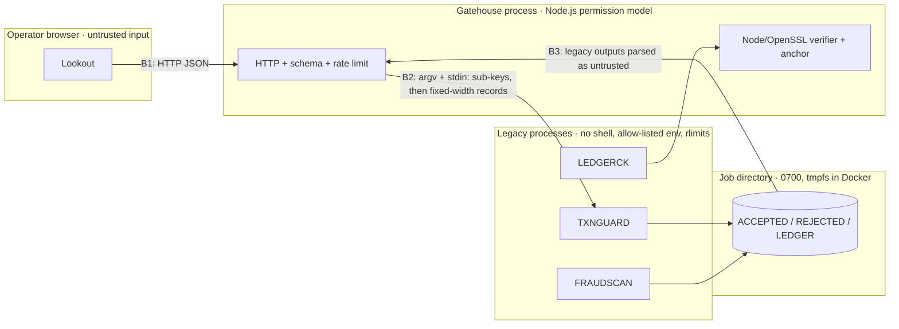

# Threat model

Alcazar demonstrates how to put a web front end on a legacy COBOL/Fortran
batch core without inheriting the web's attack surface. This document states
what is protected, from whom, where the trust boundaries are, and what is
explicitly **not** covered.

## Assets

| Asset | Why it matters |
|-------|----------------|
| Card numbers (PAN) | PCI DSS data; must never be stored or displayed in full. |
| IBANs and payment metadata | Personal data (GDPR); must be minimised and pseudonymised. |
| Integrity of decisions | A forged "accepted" or a deleted "rejected" is fraud. |
| The audit ledger (Seal) | Evidence; must be tamper-evident. |
| The master ledger key | Whoever holds it can forge ledger entries. |
| Availability of the batch core | Legacy programs are slow to restart and easy to overload. |
| Integrity of the dashboard | Script injection would let an attacker act as the operator. |

## Adversaries

1. **Remote attacker** — sends arbitrary HTTP to Gatehouse, or lures an
   operator's browser to a hostile page (CSRF, DNS rebinding, XSS payloads).
2. **Malicious insider** — has write access to the job directory and edits,
   deletes or truncates its files: after the fact, or even while a job runs
   (between TXNGUARD and Gatehouse, on TXNGUARD's input, during
   verification).
3. **Hostile contributor** — submits code that looks harmless in review
   (Trojan Source, code hidden past column 72, unsafe legacy idioms).
4. **Compromised supply chain** — a malicious npm package or base image.

## Trust boundaries

* **B1 Browser → Gatehouse.** Everything is untrusted.
* **B2 Gatehouse → legacy programs.** The legacy programs re-validate
  everything (defence in depth) and never trust Gatehouse's checks.
* **B3 Legacy outputs → Gatehouse.** Outputs are parsed strictly and treated
  as untrusted: a bug in the core must not become a bug in the front end.

## STRIDE

| Threat | Boundary | Mitigation | Verified by |
|--------|----------|------------|-------------|
| **S**poofing: cross-site requests from a hostile page | B1 | Only `application/json` bodies (forms cannot send it), `Origin` / `Sec-Fetch-Site` must be same-origin, `Host` must be local or allow-listed (DNS rebinding) | `gatehouse/test/server.test.mjs`, Siege `content-type` |
| **S**poofing: API use without the operator | B1 | Every API call but `/api/health` needs the operator: the operator token — from a `0600` file, the environment, or generated per run and printed once as a sign-in link — as a bearer token, or the session Lookout trades it for: an HttpOnly, SameSite=Strict cookie (`__Host-` and Secure over TLS). Gatehouse keeps digests only; `ALCAZAR_AUTH=none` is refused off loopback | `auth.test.mjs` |
| **T**ampering: record injection via CR/LF or over-long fields | B1, B2 | Printable ASCII only at Gatehouse; fixed-length records with no terminators in COBOL; LOW-VALUES pre-fill catches fragments | Siege `record-injection`, COBOL tests |
| **T**ampering: sign flip, truncation, fractional cents | B2 | Strict amount grammar, ON SIZE ERROR, separate sign | Siege `sign-flip`, `truncation`, `salami` |
| **T**ampering: forged identifiers (IBAN, card) | B2 | ISO 7064 MOD 97-10 with the never-issued check digits 00/01/99 refused (one account, two IBANs), ISO 13616 country lengths, Luhn | Siege `iban-checksum`, `iban-alias`, `pan-luhn` |
| **T**ampering: injection (SQL, HTML, formulas, shell) | B1, B2 | No shell anywhere (spawn with argv), SEPA character set, formula-prefix rule, DOM built without HTML parsing + Trusted Types | Siege `xss-memo`, `sqli-memo`, `formula-injection`, `cmd-injection` |
| **T**ampering: editing the ledger | Disk | HMAC-SHA256 chain over every entry and the previous MAC, files read as fixed-length records (no reader normalisation); LEDGERCK and an independent OpenSSL implementation must agree | Siege `ledger-tamper`, `ledger-delete`; `agreement.test.mjs` (250 random corruptions, identical verdicts) |
| **T**ampering: editing a decision record (redirecting a payment, rewriting a rejection) | Disk | Each ledger entry seals an HMAC of its whole ACCEPTED or REJECTED record; records with no entry are refused | Siege `record-tamper`, `ledger.test.mjs` |
| **T**ampering: truncating the ledger (and its records) | Disk | Head MAC and entry count anchored when the job is sealed, taken from TXNGUARD's stdout (not from a file in the job directory) and signed by Gatehouse (Ed25519); the auditor's tool will not call a ledger intact without an anchor | Siege `ledger-truncate`, `insider.test.mjs`, `verify-ledger.test.mjs` |
| **T**ampering: editing input or output files while a job runs | Disk | No input file: the batch is piped to TXNGUARD; sealed files read once and those bytes verified; FRAUDSCAN fed through pipes; one ledger entry per submitted transfer and every accepted record checked against the transfer Gatehouse sent (masked card and tokens recomputed); totals recomputed from the verified records; LEDGERCK and Node must agree, so concurrent edits can only yield "broken" | `insider.test.mjs` |
| **T**ampering: a risk report that hides, invents or silences a transfer | B3 | FRAUDSCAN's report must have scored exactly the accepted records, in order, with counts that add up and their amount range | `review.test.mjs` |
| **T**ampering: Trojan Source / hidden code in contributions | Repo | `scripts/check-unicode.mjs` in CI; Watchtower `ALZ-GEN-001/002`, `ALZ-COB-014` | CI |
| **R**epudiation: "that transfer was never submitted" | B2 | Every record — accepted *or rejected* — is sealed in the ledger, bound to the job id. The anchor is signed by Gatehouse alone, so whoever holds `K_ledger` (an auditor) can check a ledger but cannot seal one that matches it; with `ALCAZAR_EVIDENCE_DIR`, the sealed bytes and the signed anchor outlive the job, written once and read-only | `ledger.test.mjs`, `evidence.test.mjs`, `verify-ledger.test.mjs` |
| **I**nformation disclosure: card numbers | B2, B3 | The raw batch reaches TXNGUARD on stdin and never touches the disk, and job directories left by a crash are removed at start-up; only BIN + last 4 (ACCEPTED) or last 4 (ledger) ever leave the core; a card number typed into the memo is refused (E803), however it is grouped and whatever digits surround it | `server.test.mjs` asserts no raw PAN in responses; `review.test.mjs` (15 card formats, 8 look-alikes); Siege `pan-in-memo` |
| **I**nformation disclosure: account identity in analytics | B2 | FRAUDSCAN sees HMAC tokens (`K_token`) and masked IBANs (country, check digits, last 4), never a whole account field; a memo reaches it as typed, card numbers excepted (refused) — see the residual risks | `parseAccepted` tests |
| **I**nformation disclosure: key exposure | B2 | The master key never leaves Gatehouse; each legacy program gets only its sub-keys (LEDGERCK: `K_ledger` only), on stdin (not argv, not env), read with `read(2)` so no stdio buffer keeps a copy, wiped after use; a program handed more than its keys, or equal sub-keys, refuses to run; key file decoded as bytes and refused if group/world readable or inside the job directory. Enforced by Gatehouse, not by the operating system: the programs run as its user (see the residual risks) | `review.test.mjs`, `ALZKEYP.cpy`, `app.mjs`; memory scan (HARDENING 20) |
| **I**nformation disclosure: a job id (the key to a job) in the logs | Host | Request logs keep four hex digits of it | `auth.test.mjs` |
| **I**nformation disclosure: timing side channel on MAC checks | B3 | Constant-time comparison in Fortran (`alz_ct_equal`) and Node (`timingSafeEqual`) | `test_crypto.f90` |
| **D**enial of service: huge or many requests | B1 | 512 KiB body cap, 1,000 transactions per batch, token-bucket rate limit keyed on the trusted proxy's hop, at most 4 legacy processes at once on every path with a bounded queue, batch slots taken only after the body is read, bounded job store with TTL (a cache: with `ALCAZAR_EVIDENCE_DIR`, evicting a job deletes no evidence), header/request timeouts, bounded shutdown | `server.test.mjs`, `review.test.mjs`, Siege `flood` |
| **D**enial of service: a runaway legacy program | B2 | SIGKILL after the timeout, bounded stdout/stderr, prlimit CPU / memory / file size / no core dumps (Linux) | `runner.mjs` |
| **E**levation: path traversal | B1 | Static files served from an in-memory map; no URL becomes a path | Siege `path-traversal` |
| **E**levation: hijacking the legacy runtime | B2 | `-fstatic-call`, allow-listed environment (no `COB_LIBRARY_PATH`, `DD_*`, `LD_PRELOAD`), no shell | `runner.mjs` |
| **E**levation: compromised dependency | Supply chain | Zero npm dependencies (runtime and dev), base images pinned by digest, GitHub Actions pinned by commit SHA, Dependabot | CI, `package.json` |
| **E**levation: compromised Gatehouse code reading the host | Host | Node.js permission model (read: the application, the job and evidence directories and the two secret files; write: the job and evidence directories) for Gatehouse's own file access — not for the programs it may start (`--allow-child-process`, see the residual risks); non-root user, read-only root FS, all capabilities dropped, `no-new-privileges` | `Dockerfile`, `compose.yaml`, `review.test.mjs` |

## Residual risks and non-goals

* **TLS is not terminated by Gatehouse.** Put it behind a reverse proxy and set
  `ALCAZAR_HSTS=1`. `compose.yaml` publishes on `127.0.0.1` only; the image
  itself listens on every interface, operator authentication on.
* **The master key lives in Gatehouse's memory** (generated per start, or
  read from a `0600` file outside the job directory, ideally a read-only
  secret mount) — the legacy programs only ever see sub-keys.
  Production should keep it in an HSM/KMS and only hand Gatehouse the derived
  keys.
* **The insider is someone with the job directory, not with Gatehouse.** The
  checks above make the job directory useless as an attack surface, even
  while a job runs; whoever controls the Gatehouse process or its user
  holds the keys and is out of scope. In the shipped deployment the job
  directories are `0700` and Gatehouse's own, so this insider exists where
  that directory is shared after all: backup agents, network or shared
  storage, an administrator with file access but not Gatehouse's account.
  In Docker that user is unprivileged and the job directory is a private
  tmpfs.
* **Key separation between the legacy programs is enforced by Gatehouse, not
  by the operating system.** They run as Gatehouse's user, and the Node.js
  permission model confines Gatehouse's own file access only: with
  `--allow-child-process`, whatever it starts is unconfined. A compromised
  TXNGUARD, FRAUDSCAN or LEDGERCK — or compromised code in Gatehouse
  starting a shell — could read the master key file. Production should run
  the legacy programs as another user, or in their own container, confined
  to the job directory (Landlock, seccomp, systemd sandboxing), and use a
  runtime image without a shell.
* **Truncation detection depends on the anchor.** Gatehouse signs it
  (Ed25519) and serves it with the job; `scripts/verify-ledger.mjs` checks
  it with the public key the auditor brings and answers UNANCHORED (exit 3),
  never INTACT, without one. Without `ALCAZAR_EVIDENCE_DIR`, the files and
  the anchor live as long as the job (15 minutes, or until a restart). A
  durable deployment sets it, on storage the insider cannot write (WORM or
  object lock), or ships the signed anchors to a separate service or a
  transparency log.
* **The Fortran SHA-256 / HMAC kernel is verified against NIST and RFC 4231
  vectors and cross-checked with OpenSSL on every start-up**, but it has not
  had an independent cryptographic or side-channel audit beyond the
  constant-time comparison. For production cryptography prefer a vetted
  library (OpenSSL, libsodium) behind the same `alz.h` ABI.
* **Rate limiting is per client IP** and in memory; behind N proxies set
  `ALCAZAR_TRUST_PROXY=N` (the client is the N-th `X-Forwarded-For` entry from
  the right) and limit at the edge too.
* **Demo mode** (`ALCAZAR_DEMO=1`, which `npm start` and `compose.yaml` turn
  on for the showcase) exposes the ledger *tamper* endpoint for the Siege
  lab, to the operator only. It only rewrites the job's own files, and it is
  off by default — in the image too.
* **A memo is free text.** TXNGUARD refuses card numbers in it, not account
  numbers: an IBAN typed into a memo reaches ACCEPTED.DAT, FRAUDSCAN and the
  browser as typed.
* **Account tokens are stable pseudonyms.** The same IBAN gets the same token
  in every job under one master key — analytics can follow an account over
  time — and an operator can learn the token of any IBAN by submitting it.
  Rotate the master key, or scope tokens per period, where that link is
  not wanted.
* **Replays are caught within a batch** (E102). Gatehouse keeps no state
  between batches: idempotency across them belongs to the system of record.
* **FRAUDSCAN scores one batch at a time, on the timestamps submitted.**
  Splitting transfers across batches, or spacing their timestamps, evades
  STRUCTURING and VELOCITY.
* **Finding a card number in free text is a heuristic.** ALZPANSC catches the
  ways people type cards (groups, separators, an expiry date or CVV next to
  it, glued to a word) but not a number glued to other digits with no
  separator, spelled out in words or deliberately encoded. Measured on random
  look-alikes, valid IBANs, invoice numbers with dates and phone numbers are
  never flagged; a 16- or 19-digit reference that starts with 2–6 passes
  Luhn one time in ten and is refused like the card it looks like (4–8 % of
  random references), and so is a SIRET that starts like a Diners card
  (1.7 %). Deliberate exfiltration through the memo is
  FRAUDSCAN's ENTROPY signal's job.
* **Watchtower is a heuristic analyzer**, not a sound verifier: it has no
  full data-flow analysis and does not read EBCDIC sources. Absence of
  findings is not proof of absence of bugs.
* **GnuCOBOL and gfortran runtimes** are trusted; keep them patched.
