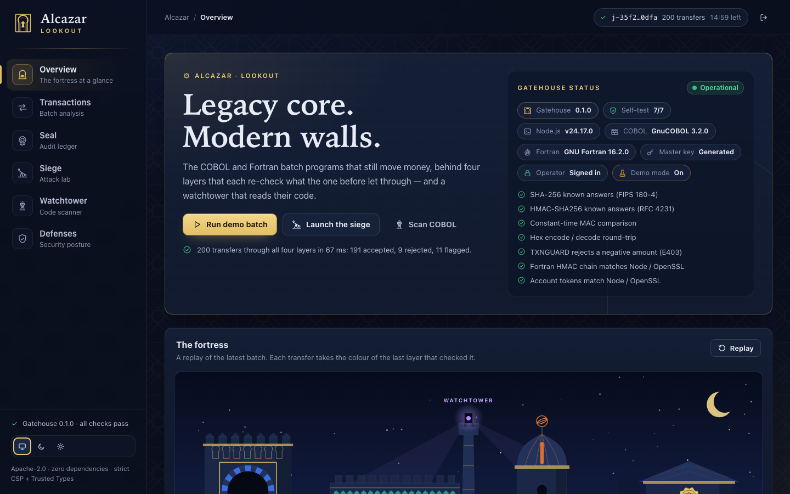
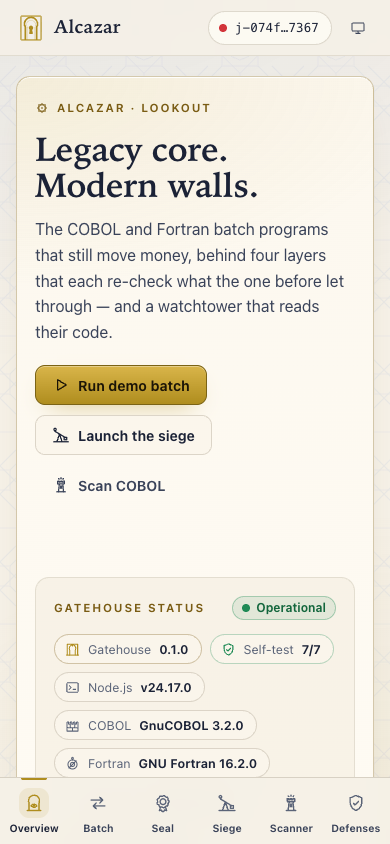
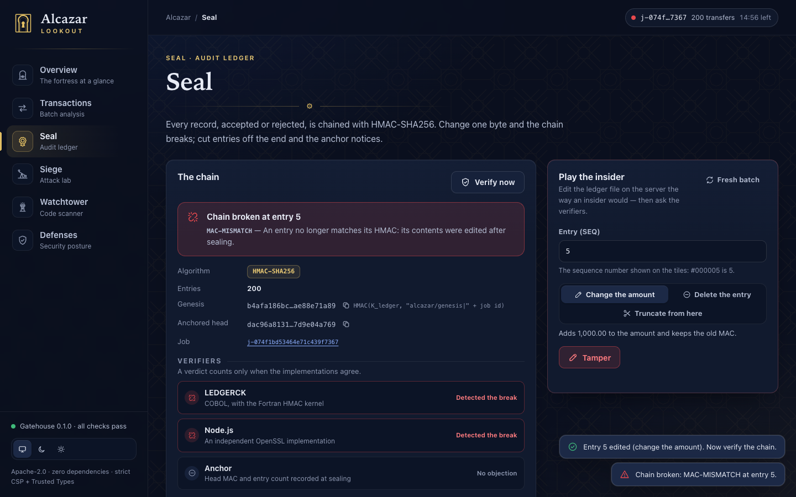
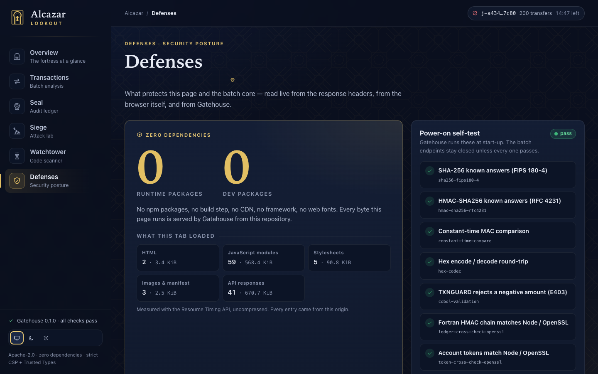

# Lookout

The dashboard of **Alcazar**. Six views over the live gateway — and a page that
is itself a demonstration of the security it reports: zero dependencies, no
build step, no inline code, every DOM node built from text, and a strict CSP
with Trusted Types that it checks on itself.

| View | What it does |
|------|--------------|
| **Overview** | Hero, Gatehouse status and the 7 power-on self-tests, the **fortress map** (a replay of the latest batch), KPI tiles |
| **Transactions** | Load a batch (Gatehouse sample, pasted JSON or a local file), run it, read rejection reasons, top risk, Benford, the log-scale amount histogram and every transfer (filter, search, record-level detail) |
| **Seal** | The HMAC-SHA256 chain: verifiers, the signed anchor (download), tamper console (demo mode), ledger map, chain of tiles that cracks at the break, byte-level inspector |
| **Siege** | All `shared/lab.mjs` scenarios against the live gateway, one by one or as a full siege ending in a wax seal |
| **Watchtower** | The COBOL/Fortran scanner running **in the browser**, the repository self-scan, the rule catalogue, SARIF download |
| **Defenses** | Headers, sandbox, compiler hardening, self-test — plus checks this page runs on itself |

<table>
  <tr>
    <td width="62%"></td>
    <td width="38%" rowspan="2"></td>
  </tr>
  <tr>
    <td></td>
  </tr>
  <tr>
    <td colspan="2"></td>
  </tr>
</table>

Screenshots are regenerated with `node scripts/screenshots.mjs` (headless Chrome,
throw-away profile) while Gatehouse runs.

## Run it

Lookout is served by Gatehouse; there is nothing to build or install.

```sh
npm run start:dev   # ALCAZAR_STATIC_RELOAD=1 ALCAZAR_DEMO=1 node gatehouse/src/server.mjs
```

Open the sign-in link Gatehouse prints (`http://localhost:8080/#signin=…`),
or paste its token into the sign-in screen: Lookout trades it for an
HttpOnly, SameSite=Strict session cookie and drops the token from the
address bar and the page. A sign-in link works in a fresh tab or in one
already open; the sign-out button sits in the top bar.

With `ALCAZAR_STATIC_RELOAD=1`
static files are re-read on every page request: edit, reload. Gatehouse serves
`lookout/` at `/` (excluding `dev`, `test`, `mock`, `README.md`), `shared/` at
`/shared/` and `watchtower/src/` at `/watchtower/src/`. The Watchtower report
and examples are built when Gatehouse starts, so restart it after changing
`examples/`.

Tests (pure modules, string table, CSP/Trusted Types lint — no browser, no network):

```sh
node --test 'lookout/test/*.test.mjs'
```

## Design

*The Alcazar of Seville at night meets the 3270 terminal.* Horseshoe arches
inside their alfiz frame, an 8-point *khatam* tessellation (`assets/zellige.svg`,
applied as a CSS mask so one file serves both themes at 4–5 % opacity), gold
leaf and lapis — next to monospace records, column rulers and hex hashes.

* **Typography** — system stacks only (no web fonts): `ui-sans-serif, system-ui…`
  for UI, `ui-monospace, SFMono-Regular…` for data, and a system serif
  (`Iowan Old Style, Palatino…`) for the wordmark and view titles. Hero and KPI
  figures stay in the sans; tabular figures only where numbers align.
* **Themes** — night ink (default) and parchment, following
  `prefers-color-scheme` with a System / Dark / Light override. A tiny
  render-blocking same-origin script (`js/theme-boot.js`) applies a saved
  choice before first paint, because CSP forbids an inline one.

### Layer colours

One identity per layer, used for every badge, chart, card and the fortress.
The suggested saffron and gold were indistinguishable (ΔE 4.4), so the values
were tuned and checked with the dataviz palette validator on **all pairs**:
normal-vision ΔE ≥ 15.6 and protan/deutan ΔE ≥ 8.4 (dark), ≥ 17.3 / ≥ 8.5
(light), each ≥ 3:1 against its surface. The dark set is deliberately brighter
than the validator's lightness band — they are luminous accents on night ink —
and colour is never the only cue: every use carries an icon and a label.
Text uses `-ink` steps that clear 4.5:1.

| Layer | Dark | Light |
|-------|------|-------|
| Gatehouse (gateway) | lapis `#3F7BFF` | `#1A4CC4` |
| COBOL (TXNGUARD, Rampart) | azulejo teal `#1FB5A3` | `#00897A` |
| Fortran (FRAUDSCAN, Rampart) | saffron `#F0782F` | `#B5430B` |
| Seal (ledger) | gold `#E2BF63` | `#AF8D1E` |
| Watchtower (scanner) | violet `#B18CFF` | `#9A6AE6` |

Status colours are reserved and always paired with an icon: myrtle `#3FB97A`,
pomegranate `#E5484D`, amber `#F5A524`. Night ink `#0A0F1E`, surfaces
`#111A2E` / `#16213A`, text `#E8ECF6` / muted `#8B95AE`; parchment `#F6F1E7`,
ivory `#FFFCF5`, ink `#1B2236`.

### Signature pieces

* **Fortress map** (`js/fortress.mjs`) — an SVG cross-section: the Gatehouse
  arch with Córdoba-style alternating voussoirs, the COBOL rampart with an
  azulejo band and portcullis, the Fortran observatory, the Seal archive, and
  the Watchtower's lantern scanning the code above. A job takes ~50 ms, so the
  animation is a *replay*, not a progress bar: up to 48 packets stand for the
  batch proportionally and take the colour of the last layer that checked them;
  rejected ones bounce off the portcullis, flagged ones get a saffron halo.
  Reduced motion draws the final state at once.
* **Seal chain** — tiles joined by gold links; verification classifies every
  entry, the broken one cracks, later ones dim as unverifiable, missing entries
  (delete, truncate) appear as ghost tiles. The inspector shows the 312-byte line
  under a 3270 ruler with the 247-byte MAC-input boundary marked; a rewritten
  ACCEPTED or REJECTED record is shown in its own layout, before and after.
* **Siege** — cards resolve to a shield in the containing layer's colour
  ("Contained by COBOL · E403") or fail loudly; the full siege ends in a wax
  seal ringed with one dot per scenario.
* **Watchtower** — a real `<textarea>` (native editing and screen-reader
  support) with a synchronized gutter, severity markers, the column ruler and
  fixed-form guides (sequence area, indicator, area A, the column-72 margin).

## Security approach

The gateway sends
`default-src 'none'; script-src 'self'; style-src 'self'; img-src 'self'; … require-trusted-types-for 'script'; trusted-types 'none'`.
Lookout works under it with no console violations on any view:

* **No markup parsing, ever.** `js/dom.mjs` builds everything with
  `createElement` / `createElementNS` and text nodes. It refuses executable or
  embedding tags (`script`, `iframe`, `object`, `foreignObject`, `style`…),
  `on*` and `style` attributes, unsafe properties, and — in `href`, `src`,
  `action`, `xlink:href` and `poster` — any URL that is not http(s), mailto,
  blob, fragment or same-origin. With `trusted-types 'none'`
  no policy can exist, so `innerHTML`-style sinks are simply never used.
* **Styles without style attributes.** Dynamic geometry goes through the CSSOM
  (`element.style.setProperty('--x', …)`) or SVG presentation attributes.
* **Untrusted API data.** `js/api.mjs` is the only module that knows the
  contract; every response is projected onto its fields with explicit types,
  unknown values dropped and maps rebuilt on null-prototype objects (a JSON
  `__proto__` key can't pollute anything). Values reach the DOM only as text.
* **Trojan Source.** Control, bidi and zero-width characters in untrusted text
  (memos, ids, scanner snippets, Siege payloads) render as visible escapes
  (`\u{202E}`); the scanner warns and offers a reveal view when a source
  contains them.
* **Masked data only.** Once a batch is sent the transactions view lets go
  of it, pasted text included, and keeps a masked projection: IBAN first 4 +
  last 4, PAN BIN + last 4, and down to its last 4 every stretch of digits
  in a memo that could be a card number — ALZPANSC's test, with groups up
  to four punctuation characters apart — so the card numbers TXNGUARD
  refused (E803), and any it missed between other punctuation, are hidden
  while dates, amounts and phone numbers stay readable. Accepted memos and tampered records are shown masked the same way.
* **Storage** holds per-viewer conveniences only: theme, last view
  (`localStorage`), and the current job id (`sessionStorage`), all wrapped in
  try/catch. No data leaves for third parties; Defenses verifies this live.
* **Siege back-off.** The lab's `fetch` waits out `P-RATE` / `P-BUSY` so the
  rate limiter is never mistaken for the layer that contained an attack.

The only console lines during a Siege are the browser's own
"Failed to load resource" notices for the attack requests the gateway refuses
(400 / 404 / 415) — they are the expected answers. The opt-in
"Try to create a policy" probe on Defenses deliberately triggers one Trusted
Types violation to prove enforcement.

## Accessibility

Landmarks (banner, navigation, main, contentinfo), a skip link, focus moved to
the view title on navigation with an announcement, visible focus rings, native
radios for every segmented control, `<dialog>` drawers (focus trap, Escape,
focus restored), `role="status"` progress lines and a polite announcer for
batches, verification and the siege. Charts are SVG groups whose marks are
reachable with one tab stop and arrow keys (the same tooltip as hover), each
with a text summary and a *View as table* twin. Tables keep their semantics
when they stack into cards on phones. `prefers-reduced-motion` turns animation
off; `forced-colors` keeps borders and marks visible. A contrast sweep of every
view in both themes found no text below WCAG AA after the token fixes.
Responsive from 360 px phones (bottom tab bar) through tablets (icon rail) to
wide desktops, with no horizontal page scroll.

## Contract notes

Decisions made where `docs/ARCHITECTURE.md` leaves room, so other clients match:

* `risk.amounts.histogram.log10Edges` are read as log10 of **major units**
  (as Gatehouse sends them); a guard converts if a backend sends cents.
* Tamper `seq` is the 1-based **position** in the current ledger file (it differs
  from the entry's own number after a delete); the UI calls it with positions.
* `verifiedBy` is read as "the verifiers that reported this verdict": all three
  when valid, LEDGERCK + Node/OpenSSL for an internal break, the anchor alone
  for `HEAD-MISMATCH`.
* `GET /api/jobs/:id` returns the last verification; after a tamper the page
  marks it stale until `POST …/verify` runs again.
* `WatchtowerFileResult.file` is the repository-relative path; the UI computes
  severity counts from the results rather than trusting a summary shape.
* Static 404s and unknown API paths answer with the JSON `P-NOTFOUND` error, as
  the path-traversal scenario expects.

## Layout

```
index.html             shell: landmarks, live regions, module entry
manifest.webmanifest
assets/                favicon, logo, zellige tessellation (CSS mask)
css/                   base (tokens, themes) · shell · components · views · charts
js/main.mjs            shell, theme, routing, sign-in links
js/signin.mjs          the sign-in screen
js/dom.mjs             the only DOM builder
js/api.mjs             the only network module (contract + Siege fetch)
js/strings.mjs         every UI string
js/format.mjs records.mjs batch.mjs jobmodel.mjs   pure, tested in Node
js/fortress.mjs editor.mjs recordview.mjs jobui.mjs ui.mjs icons.mjs charts/  views/
test/dom.test.mjs actions.test.mjs   node:test suites
```
